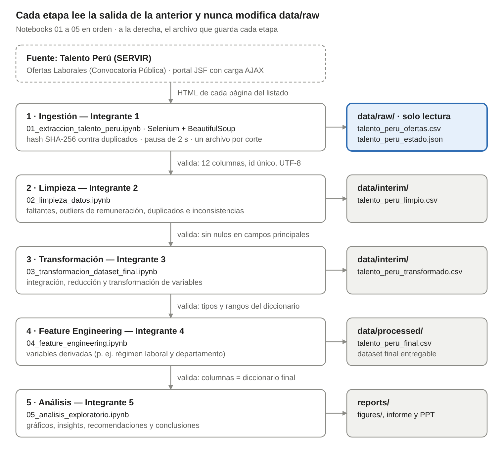

# Ofertas laborales del sector público peruano: preprocesamiento y análisis

**Proyecto Final · Parte II: Preprocesamiento de Datos y Data Analytics Product**
DS3021 Análisis Computacional de Datos · UTEC · 2026-2 · Grupo 7 · Entrega: 11 de noviembre de 2026

Análisis computacional de las convocatorias públicas publicadas en Talento Perú (SERVIR) para identificar qué perfiles y características de puestos demanda el Estado, como apoyo a estudiantes universitarios y recién egresados. La Parte I construyó el dataset mediante web scraping; esta Parte II lo limpia, transforma, enriquece y analiza con un pipeline reproducible.

## Contenido

1. [Problema y objetivo](#problema-y-objetivo)
2. [Equipo y responsabilidades](#equipo-y-responsabilidades)
3. [Estructura del repositorio](#estructura-del-repositorio)
4. [Pipeline de datos](#pipeline-de-datos)
5. [Instalación](#instalación)
6. [Ejecución](#ejecución)
7. [Datos](#datos)
8. [Validación y calidad](#validación-y-calidad)
9. [Limitaciones](#limitaciones)
10. [Fuente y uso de los datos](#fuente-y-uso-de-los-datos)
11. [Entorno verificado](#entorno-verificado)

## Problema y objetivo

Las convocatorias del Estado están dispersas entre cientos de entidades, cada una con su propio perfil, régimen, remuneración y ubicación. Eso dificulta saber qué puestos y características se priorizan en la contratación pública.

**Objetivo de la Parte II:** transformar el dataset de ofertas extraído en la Parte I en información útil mediante limpieza, integración, reducción, transformación y Feature Engineering, y analizarlo para obtener hallazgos y recomendaciones para estudiantes y egresados.

> El contexto y los objetivos específicos actualizados según los datos disponibles están en el informe (sección 2 y 3) y en `notebooks/04_feature_engineering.ipynb`.

## Equipo y responsabilidades

| Rol | Integrante | Responsabilidad | Entregables en el repositorio |
|---|---|---|---|
| 1 · Organización y pipeline | *Por definir* | Estructura del repositorio, pipeline de ingestión, validación y almacenamiento, reproducibilidad, integración del trabajo del equipo | `README.md`, `requirements.txt`, `run_pipeline.py`, `src/`, `tests/`, `docs/pipeline.md`, `notebooks/01_extraccion_talento_peru.ipynb` |
| 2 · Limpieza | *Por definir* | Valores faltantes, outliers, duplicados e inconsistencias, con la justificación de cada decisión | `notebooks/02_limpieza_datos.ipynb`, `data/interim/talento_peru_limpio.csv`, `docs/decisiones/02_limpieza.csv` |
| 3 · Transformación y dataset final | *Por definir* | Integración, reducción y transformación de variables; diccionario de datos final | `notebooks/03_transformacion_dataset_final.ipynb`, `docs/diccionario_datos_final.csv` y `.pdf` |
| 4 · Objetivos y Feature Engineering | *Por definir* | Contexto y objetivos actualizados; variables derivadas y su justificación | `notebooks/04_feature_engineering.ipynb`, `data/processed/talento_peru_final.csv` |
| 5 · Análisis y conclusiones | *Por definir* | Exploración, visualizaciones, insights, recomendaciones y conclusiones | `notebooks/05_analisis_exploratorio.ipynb`, `reports/figures/` |

Las reglas para trabajar en el repositorio (ramas, commits, notebooks) están en [CONTRIBUTING.md](CONTRIBUTING.md).

## Estructura del repositorio

```text
├── README.md
├── CONTRIBUTING.md                 # reglas de trabajo del equipo
├── requirements.txt                # dependencias
├── run_pipeline.py                 # ejecuta y valida las etapas en orden
├── data/
│   ├── raw/                        # dataset inicial (solo lectura)
│   │   ├── talento_peru_ofertas.csv
│   │   └── talento_peru_estado.json
│   ├── interim/                    # salidas de limpieza y transformación
│   └── processed/                  # dataset final
├── notebooks/
│   ├── 01_extraccion_talento_peru.ipynb
│   ├── 02_limpieza_datos.ipynb
│   ├── 03_transformacion_dataset_final.ipynb
│   ├── 04_feature_engineering.ipynb
│   └── 05_analisis_exploratorio.ipynb
├── src/
│   ├── config.py                   # rutas y constantes compartidas
│   ├── extraccion.py               # extractor de Talento Perú (Selenium + BeautifulSoup)
│   ├── validacion.py               # contratos de datos entre etapas
│   ├── registro.py                 # registro de decisiones de preprocesamiento
│   └── graficos.py                 # guardado uniforme de figuras
├── tests/                          # pruebas automáticas (pytest)
├── docs/
│   ├── pipeline.md                 # documentación técnica del pipeline
│   ├── diccionario_datos_inicial.pdf / .csv
│   ├── diccionario_datos_final.csv # (y .pdf al cierre)
│   ├── decisiones/                 # una tabla de decisiones por etapa
│   └── img/pipeline.png
└── reports/
    └── figures/                    # gráficos del informe
```

## Pipeline de datos



| Etapa | Notebook | Lee | Escribe |
|---|---|---|---|
| 1. Ingestión | `01_extraccion_talento_peru` | Portal Talento Perú | `data/raw/talento_peru_ofertas.csv` |
| 2. Limpieza | `02_limpieza_datos` | `data/raw/talento_peru_ofertas.csv` | `data/interim/talento_peru_limpio.csv` |
| 3. Transformación | `03_transformacion_dataset_final` | `data/interim/talento_peru_limpio.csv` | `data/interim/talento_peru_transformado.csv` |
| 4. Feature Engineering | `04_feature_engineering` | `data/interim/talento_peru_transformado.csv` | `data/processed/talento_peru_final.csv` |
| 5. Análisis | `05_analisis_exploratorio` | `data/processed/talento_peru_final.csv` | `reports/figures/` |

Cada notebook empieza validando el archivo de la etapa anterior y termina validando el suyo; si un contrato no se cumple, se detiene. La justificación técnica del diseño (procesamiento por lotes, capas, idempotencia, linaje, formato de almacenamiento) está en [docs/pipeline.md](docs/pipeline.md).

## Instalación

Requisitos: **Python 3.10 a 3.13** y Git. Google Chrome solo hace falta para generar un corte nuevo de datos.

**Windows (PowerShell)**

```powershell
git clone https://github.com/JaimeRamosT/Preprocesamiento-de-datos-y-Data-Analytics-Product.git
cd Preprocesamiento-de-datos-y-Data-Analytics-Product
python -m venv .venv
.venv\Scripts\Activate.ps1
python -m pip install --upgrade pip
python -m pip install -r requirements.txt
```

Si PowerShell bloquea la activación, ejecutar una vez `Set-ExecutionPolicy -Scope CurrentUser RemoteSigned`.

**Linux o macOS**

```bash
git clone https://github.com/JaimeRamosT/Preprocesamiento-de-datos-y-Data-Analytics-Product.git
cd Preprocesamiento-de-datos-y-Data-Analytics-Product
python3 -m venv .venv
source .venv/bin/activate
python -m pip install --upgrade pip
python -m pip install -r requirements.txt
```

**Google Colab**

```python
!git clone https://github.com/JaimeRamosT/Preprocesamiento-de-datos-y-Data-Analytics-Product.git
%cd Preprocesamiento-de-datos-y-Data-Analytics-Product/notebooks
!pip install -q -r ../requirements.txt
```

Para trabajar un notebook en Colab: *Archivo → Abrir notebook → GitHub*, elegir el notebook y agregar al inicio una celda con las tres líneas anteriores. La celda de preparación ubica la raíz del repositorio a partir de la carpeta actual.

## Ejecución

Todos los comandos se ejecutan en la raíz del repositorio con el entorno virtual activado.

| Para… | Comando |
|---|---|
| Ejecutar y validar todo el pipeline (etapas 02 a 05) | `python run_pipeline.py` |
| Incluir el notebook 01 (con la extracción desactivada) | `python run_pipeline.py --con-01` |
| Retomar desde una etapa o detenerse en otra | `python run_pipeline.py --desde 03 --hasta 04` |
| Solo validar los archivos existentes | `python run_pipeline.py --solo-validar` |
| Correr las pruebas automáticas | `python -m pytest` |
| Generar un corte nuevo de prueba (requiere Chrome) | `python run_pipeline.py --extraer --limite 30 --hasta 01` |
| Trabajar notebook por notebook | `jupyter notebook` y abrir `notebooks/` en orden |

La extracción está desactivada por defecto: las ofertas del dataset inicial ya cerraron, así que una corrida nueva genera un corte distinto. Cada corte nuevo se guarda en su propio archivo (`data/raw/talento_peru_ofertas_AAAAMMDD.csv`) y nunca reemplaza al dataset inicial.

## Datos

**Dataset inicial** · `data/raw/talento_peru_ofertas.csv` · [diccionario](docs/diccionario_datos_inicial.pdf)

| Característica | Valor |
|---|---|
| Fuente | Talento Perú (SERVIR), sección "Ofertas Laborales (Convocatoria Pública)" |
| Corte | Ofertas publicadas el 17 y 18 de septiembre de 2026; extracción del 18 de septiembre de 2026 (05:58 a 06:05 UTC) |
| Volumen | 1010 ofertas únicas, 12 columnas, 105 páginas del listado, 1762 vacantes |
| Calidad | 0 nulos, 0 duplicados, `id_oferta_hash` reproducible en las 1010 filas |
| Formato | CSV, UTF-8, separador coma |

**Dataset final** · `data/processed/talento_peru_final.csv` · [diccionario](docs/diccionario_datos_final.csv)

> Se completa al cerrar las etapas 2 a 4: número de filas y columnas, variables nuevas y limitaciones.

## Validación y calidad

| Contrato | Se revisa | Si falla |
|---|---|---|
| `raw` | 12 columnas en orden, sin nulos, id único, tipos, hash reproducible | Error; los valores sospechosos se reportan como advertencias |
| `limpio` | Id único, sin nulos en los 8 campos principales, vacantes ≥ 1, remuneración > 0, fin ≥ inicio, ningún puesto numérico | Error |
| `transformado` | Id único, tipos, nulos por columna | Error; los nulos se reportan |
| `final` | Id único, ≤ 10 % de nulos por columna, columnas iguales al diccionario final | Error |

`python run_pipeline.py --solo-validar` muestra el estado de todas las etapas. Cada decisión de preprocesamiento queda en `docs/decisiones/`.

## Limitaciones

- Una sola fuente: sección "Ofertas Laborales (Convocatoria Pública)" de Talento Perú; no incluye el sector privado ni las secciones de Prácticas, Contratación Directa y Cooperación Laboral.
- Se usa el listado, no la ficha de detalle: no hay experiencia requerida, formación académica ni duración del contrato.
- Es un corte de dos días de publicación: describe la demanda en ese momento, no una tendencia en el tiempo.
- El dataset reúne las primeras 1010 ofertas del listado, no todas las vigentes ese día.
- El extractor depende de la estructura HTML del portal; si SERVIR la cambia, hay que actualizar los selectores de `src/extraccion.py`.

## Fuente y uso de los datos

Los datos son públicos: las entidades de la Administración Pública registran por norma sus convocatorias en el aplicativo de SERVIR. El dataset describe ofertas y entidades, no personas, por lo que no involucra datos personales (Ley N.° 29733). La extracción espera 2 segundos entre páginas para no sobrecargar el portal.

## Entorno verificado

El pipeline y las pruebas se ejecutaron en un entorno limpio instalado desde `requirements.txt`:

| | Python 3.13 (Linux) | Python 3.10 (Linux) |
|---|---|---|
| pandas | 2.3.3 | 2.3.3 |
| numpy | 2.5.4 | 2.2.6 |
| scipy | 1.18.1 | 1.15.3 |
| scikit-learn | 1.9.1 | 1.7.2 |
| matplotlib | 3.11.2 | 3.10.9 |
| seaborn | 0.13.2 | 0.13.2 |
| selenium | 4.52.0 | 4.52.0 |
| beautifulsoup4 | 4.15.0 | 4.15.0 |
| notebook / nbclient | 7.6.5 / 0.11.0 | 7.6.5 / 0.11.0 |
| pytest | 9.2.0 | 9.2.0 |
| Pruebas | 14 de 14 | 12 de 12 (las 2 de navegación se omiten si no hay Chrome) |
