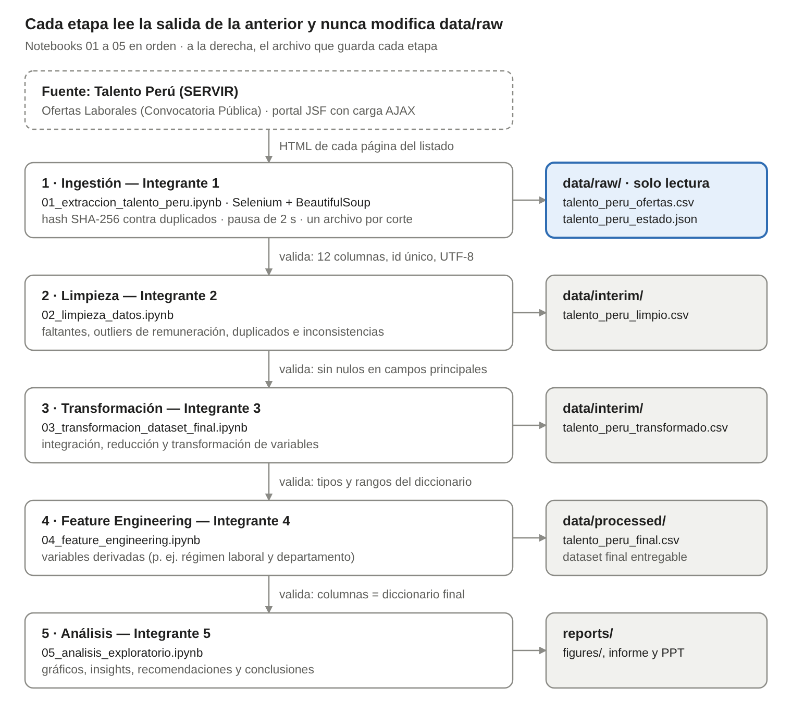

# Pipeline de datos

El proyecto usa un pipeline ETL por lotes de cinco etapas. Cada etapa es un notebook que lee un archivo, lo valida, lo procesa y escribe otro en la capa siguiente; así cualquier etapa se puede repetir sin volver a extraer los datos y sin tocar el dataset inicial.

Responsable: Integrante 1 (organización del proyecto y pipeline de datos).



## Etapas y contratos de datos

| Etapa | Responsable | Lee | Escribe | Contrato que debe cumplir la salida |
|---|---|---|---|---|
| 1. Ingestión | Integrante 1 | Portal Talento Perú | `data/raw/talento_peru_ofertas.csv`, `talento_peru_estado.json` | `raw`: 12 columnas en orden, sin nulos, id único, tipos correctos, hash reproducible |
| 2. Limpieza | Integrante 2 | `data/raw/talento_peru_ofertas.csv` | `data/interim/talento_peru_limpio.csv` | `limpio`: id único; sin nulos en los 8 campos principales; vacantes ≥ 1; remuneración > 0 y ≥ umbral; fin ≥ inicio; ningún puesto numérico |
| 3. Transformación | Integrante 3 | `data/interim/talento_peru_limpio.csv` | `data/interim/talento_peru_transformado.csv` | `transformado`: id único, tipos correctos, nulos reportados por columna |
| 4. Feature Engineering | Integrante 4 | `data/interim/talento_peru_transformado.csv` | `data/processed/talento_peru_final.csv` | `final`: id único, ≤ 10 % de nulos por columna, columnas iguales al diccionario final |
| 5. Análisis | Integrante 5 | `data/processed/talento_peru_final.csv` | `reports/figures/` | No escribe datos |

Las rutas están definidas una sola vez en `src/config.py` y los contratos en `src/validacion.py`.

## Fundamentos de ingeniería de datos

| Decisión | Justificación |
|---|---|
| **Procesamiento por lotes** | El objetivo es describir un corte del mercado laboral público. Un snapshot fechado basta y evita mantener un proceso continuo (streaming) que el problema no necesita. |
| **Capas `raw` → `interim` → `processed`** | Equivalen a las capas bronce, plata y oro. El dato crudo es inmutable, así que cada decisión de limpieza se puede auditar y cualquier etapa se puede rehacer desde su entrada. |
| **Idempotencia** | `id_oferta_hash` (SHA-256 de los 8 campos principales) evita duplicados al reanudar una extracción. Cada notebook, al volver a ejecutarse, solo reemplaza su propia salida. |
| **Linaje y trazabilidad** | `pagina_origen`, `fuente_url` y `fecha_extraccion_utc` llevan cada fila hasta la página de la que salió. El hash se puede recalcular: coincide en las 1010 filas del dataset inicial. |
| **Contratos de esquema entre etapas** | Cada notebook valida su entrada (`validacion.cargar_entrada`) y su salida. Si una etapa entrega columnas o valores fuera de lo acordado, el pipeline se detiene en ese punto y no propaga el error. |
| **CSV UTF-8 como almacenamiento** | 1010 filas y unos 315 KB no justifican una base de datos. CSV es el formato que pide el curso para el Data Asset, se versiona en Git y se abre sin instalar nada. Parquet o SQLite serían la mejora si el volumen creciera. |
| **Orquestación con un comando** | `run_pipeline.py` ejecuta los notebooks en orden con `nbclient`, guarda sus salidas y valida cada archivo. Es el equivalente mínimo de un DAG sin infraestructura adicional. |

## Etapa 1 · Ingestión en detalle

El portal está construido con JavaServer Faces (PrimeFaces) y carga el listado con AJAX, por eso se usa **Selenium** para navegar y **BeautifulSoup** para leer el HTML de cada página.

1. Selenium abre el portal sin interfaz y espera hasta 20 s a que aparezcan las tarjetas `.cuadro-vacantes`.
2. Por cada página se lee el indicador "Página X de Y" y se registra la hora UTC.
3. Cada tarjeta se convierte en un registro: se normalizan espacios, las vacantes pasan a entero, la remuneración a decimal y las fechas a `AAAA-MM-DD`. Si falta un campo principal, la tarjeta se descarta y se cuenta.
4. Se calcula el hash; las ofertas ya presentes en el archivo del corte se omiten y las nuevas se agregan al CSV en el momento.
5. La corrida termina al llegar al límite, a la última página o si el botón "Siguiente" está desactivado. Entre páginas se esperan 2 s.
6. Al terminar, o si ocurre un error, se guarda el estado de la corrida en JSON (páginas, ofertas nuevas, repetidas, incompletas, duración y motivo de fin).

### Cambios respecto a la Parte 1

| # | Problema | Corrección |
|---|---|---|
| 1 | Volver a ejecutar agregaba filas al mismo CSV y mezclaba fechas de corte | Un archivo por corte (`talento_peru_ofertas_AAAAMMDD.csv`); el extractor se niega a escribir sobre el dataset inicial |
| 2 | `fecha_extraccion_utc` se calculaba una sola vez, pero el CSV entregado tiene una marca por página | Se registra por página |
| 3 | Solo funcionaba con Chromium + ChromeDriver en el PATH | En Windows y macOS usa Google Chrome con Selenium Manager |
| 4 | El archivo de estado nunca se escribía | Se guarda siempre; el del corte inicial se reconstruyó desde el CSV y está marcado como `reconstruido` |
| 5 | Rutas relativas a `..` | Rutas desde `src/config.py` |
| 6 | El botón "Siguiente" dependía de un id autogenerado por JSF | Si el id cambia, se busca por su texto |

## Validación

Cada contrato distingue dos niveles:

- **Error:** rompe el contrato (columnas faltantes, ids duplicados, nulos en campos obligatorios, tipos incorrectos, reglas de negocio después de la limpieza). Detiene el pipeline.
- **Advertencia:** valor sospechoso que la etapa siguiente debe revisar y justificar. Por ejemplo, el contrato `raw` advierte 4 remuneraciones menores a S/ 1000 (S/ 1, S/ 1, S/ 10 y S/ 200) y un puesto con valor `"1"`; el contrato `limpio` las convierte en errores.

```bash
python -m src.validacion             # todas las etapas con archivo
python -m src.validacion limpio      # una etapa
python run_pipeline.py --solo-validar
```

## Reproducibilidad

- `requirements.txt` con rangos de versiones compatibles con Python 3.10 a 3.13 en Windows, Linux, macOS y Colab; las versiones exactas verificadas están en el README.
- `config.SEMILLA = 42` como `random_state` de K-means u otro proceso aleatorio.
- La extracción está desactivada por defecto: el dataset inicial queda fijo y el resto del pipeline siempre parte de los mismos datos.
- `.gitattributes` guarda los CSV byte a byte, para que Git en Windows no cambie los finales de línea del dataset.
- `python -m pytest` corre 14 pruebas: parseo de tarjetas (reproduce el hash de la primera fila del dataset), hash de las 1010 filas, contratos de validación y navegación con Selenium sobre un portal simulado (paginación, límite, reanudación sin duplicados y archivo de estado).

## Riesgos y contingencias

| Riesgo | Contingencia implementada |
|---|---|
| Carga lenta del portal | Esperas explícitas de hasta 20 s antes de leer cada página |
| Interrupción de la corrida | CSV incremental + hash: se reanuda sin duplicar; el estado JSON registra el motivo |
| Bloqueo por exceso de solicitudes | Pausa de 2 s entre páginas |
| Tarjetas incompletas | Se descartan y se cuentan en el estado |
| El listado termina antes del límite | Se detiene en la última página o con el botón desactivado |
| Cambia el id autogenerado del botón "Siguiente" | Búsqueda alternativa por el texto "Sig." |
| Cambia la estructura HTML del portal | Las pruebas con HTML de referencia muestran qué selector dejó de funcionar |
| Una nueva corrida mezcla cortes | Un archivo por corte; dataset inicial protegido |
| Diferencias entre Windows, Linux y Colab | Rutas desde `src/config.py`, detección del navegador, rangos de versiones |
| Una etapa entrega un esquema distinto | Los contratos detienen el pipeline en esa etapa |

## Registro de decisiones

Cada etapa registra sus decisiones con `src/registro.py` en `docs/decisiones/<etapa>.csv` (paso, acción, filas afectadas y justificación). Para reunirlas en una sola tabla para el informe:

```python
from src.registro import todas_las_decisiones
todas_las_decisiones()
```
